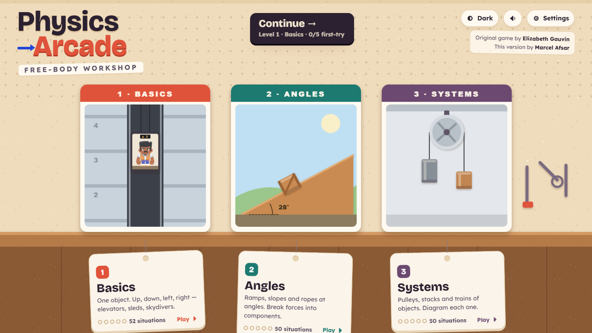
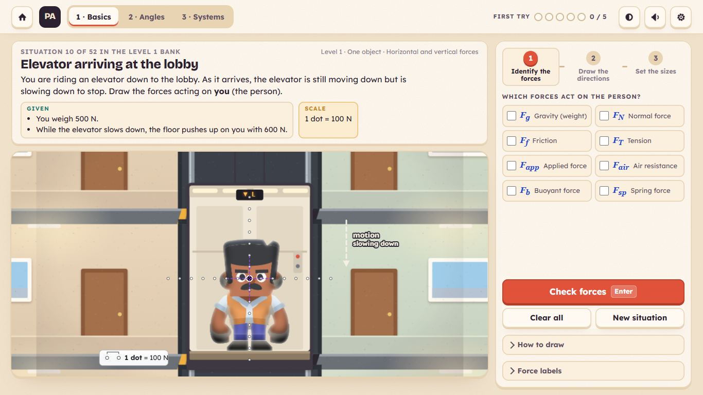
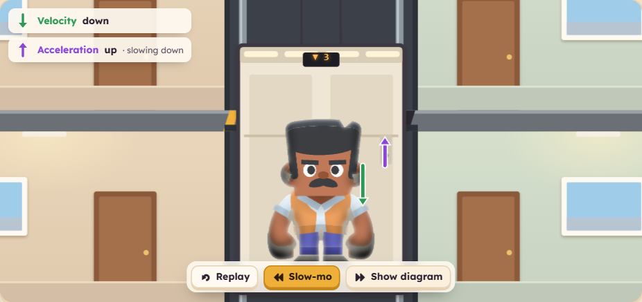
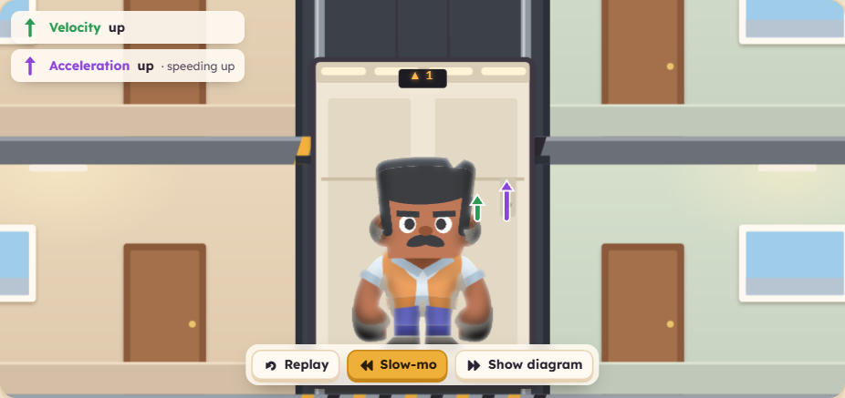
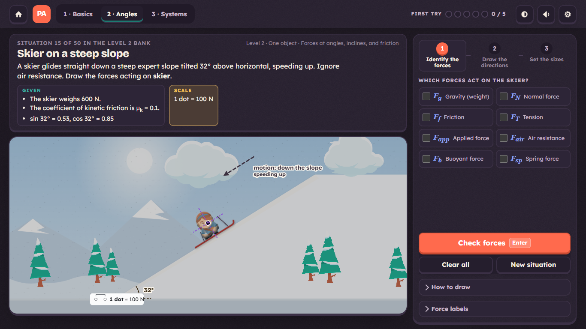
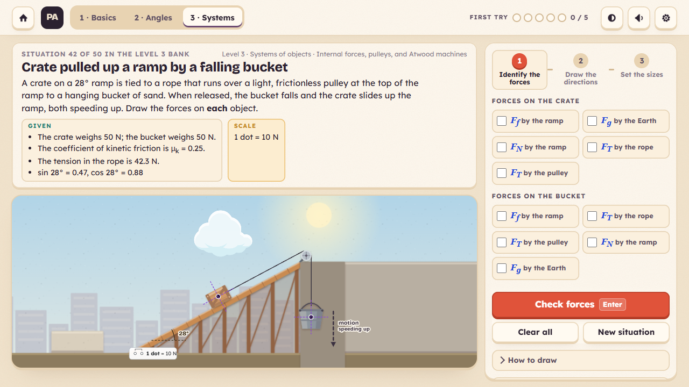

# Physics Arcade · Free-Body Workshop

**A game for practicing free-body diagrams. It has 152 teacher-written physics situations, illustrated scenes and motion replays, and it runs offline as one HTML file.**

*Original game by **Elizabeth Gauvin** · This version by **Marcel Afsar***



## Play

Open **`dist/Physics_Arcade.html`** in any modern browser. It needs no internet, install or login, and all three levels are open from the start.

## How it works

Each situation has three steps: **identify** the forces, **draw** their directions, then set their **sizes**.



A correct diagram unlocks a short **motion replay**. Velocity (green) and acceleration (purple) are shown as separate arrows. Here, an elevator moving down while slowing has velocity ↓ and acceleration ↑.



| Basics · 52 | Angles · 50 | Systems · 50 |
| :---: | :---: | :---: |
| Elevators, sleds, skydivers | Ramps and ropes at angles | Pulleys, stacks and trains |
|  |  |  |

## Features

- 🎨 Illustrated scenes drawn to the original geometry
- ✅ Green check and chime on success, and a hint ladder when you're stuck
- 🌗 Light and dark mode, with sound, volume and reduce-motion settings
- ⌨️ Mouse, touch and full keyboard play, plus a quick tutorial
- 📱 Works on phones, tablets and desktops

## The teacher's content is untouched

The 152 situations, answers, hints and explanations are Elizabeth Gauvin's, and they run **byte-for-byte unmodified**. `npm test` checks this every run: all 152 answer keys pass, and 760 wrong answers are rejected.

## Develop

```bash
npm install
```
```bash
npm run dev
```
```bash
npm run build
```
```bash
npm test
```

`npm run dev` starts a dev server at http://localhost:5173. `npm run build` writes `dist/Physics_Arcade.html`, and `npm test` runs the browser test suite against that build.

Built with [PixiJS](https://pixijs.com) and [Vite](https://vitejs.dev). For architecture and art direction, see [`docs/DESIGN.md`](docs/DESIGN.md). For test results, see [`TEST_REPORT.md`](TEST_REPORT.md).

## Credits

- **Original game:** Elizabeth Gauvin, *Free Body Diagram Practice*
- **This version:** Marcel Afsar
- **Art and sound:** [Kenney](https://kenney.nl) (CC0)
- **Fonts:** Lexend and Bricolage Grotesque (SIL OFL)

Asset licences are listed in [`ASSET_PROVENANCE.md`](ASSET_PROVENANCE.md).
